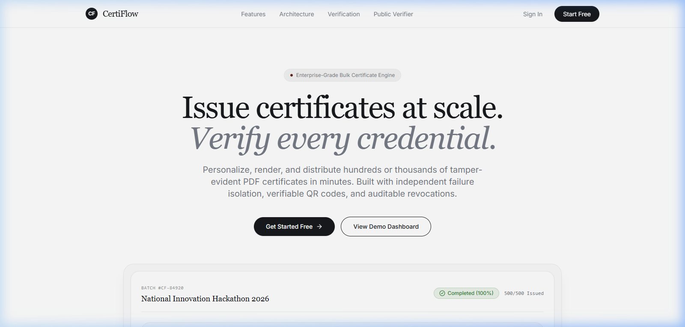
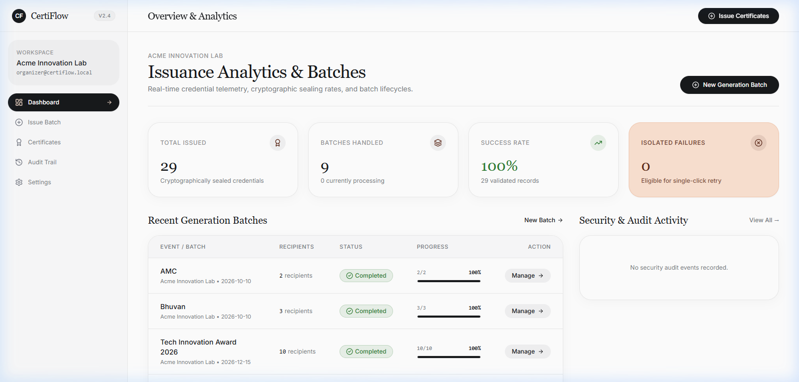
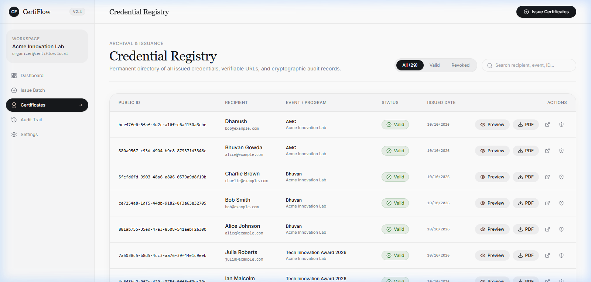
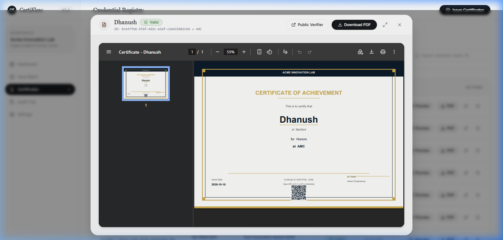
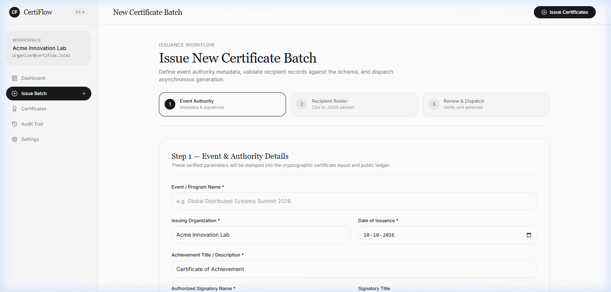
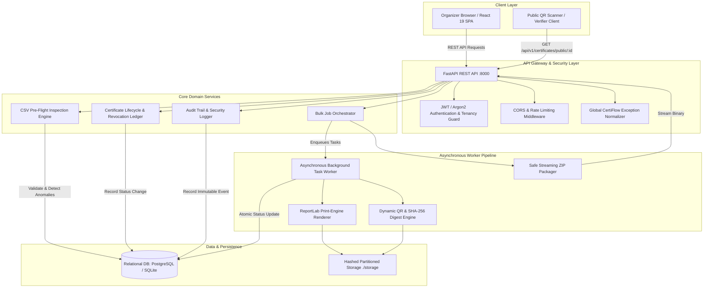
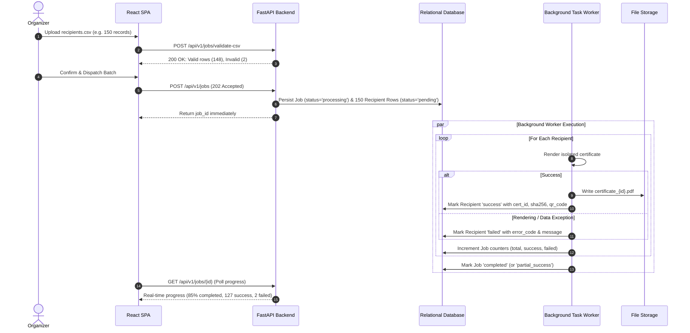
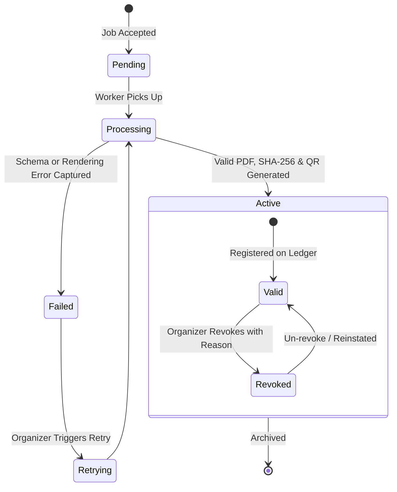

# CertiFlow — Bulk Certificate Generation, Cryptographic Verification & Lifecycle Platform

[](https://github.com/bhuvanvokkaliga29/CertiFlow)
[](https://github.com/bhuvanvokkaliga29/CertiFlow)
[](https://fastapi.tiangolo.com)
[](https://react.dev)
[](https://www.typescriptlang.org)
[](LICENSE)

> **"Issue with confidence. Verify with cryptographic certainty. Survive partial failures gracefully."**

CertiFlow is a production-grade, multi-tenant credential platform architected to solve the real-world engineering bottlenecks of enterprise certificate generation: **catastrophic batch halt**, **unvalidated CSV data corruption**, **lack of cryptographic verification**, and **untraceable credential lifecycles**.

---

## Interface Gallery

| 01. Editorial Landing & Verifier | 02. Analytics Dashboard & Telemetry |
| :---: | :---: |
|  |  |
| *Editorial serif headlines on warm paper canvas with public search.* | *Real-time batch progress, health breakdown, and security audit feed.* |

| 03. Certificate Registry & Lifecycle | 04. High-Fidelity PDF & QR Modal |
| :---: | :---: |
|  |  |
| *Status filtering, instant search, and immediate revocations.* | *In-browser PDF preview with embedded QR code & SHA-256 seal.* |

| 05. 3-Step Batch Issuance Wizard |
| :---: |
|  |
| *Pre-flight CSV validation engine with row-by-row syntax & formula injection protection.* |

---

## 1. The Hard Engineering Problems Solved

Most certificate generators fail in production when scaling past a toy demo. CertiFlow addresses the real architectural hurdles:

| Critical Failure Mode | Why Existing Tools Fail | How CertiFlow Solves It |
| :--- | :--- | :--- |
| **All-or-Nothing Batch Failure** | An exception on row 482 of a 500-recipient batch crashes the entire script, leaving partial undefined DB state and 0 certificates for valid recipients. | **Isolated Worker Pipeline:** Each recipient record is processed in an isolated unit of execution. Failures capture exact error codes and stack traces while sibling certificates continue generating smoothly. |
| **CSV Formula Injection & Malformed Rows** | Uploaded CSVs containing `=CMD\|' /C CALC'!A0` or malformed quotes corrupt database columns and introduce security vulnerabilities. | **Pre-Flight Inspection Engine:** Strict sanitization, MIME-type enforcement, Pydantic v2 field validators, and CSV escape stripping before any background processing begins. |
| **Credential Forgery & Tampering** | Sequential integer IDs (`cert/104`) allow brute-force scraping and unverified PDF edits. | **Cryptographic Verification Ledger:** Every certificate generates an unguessable UUIDv4, SHA-256 content signature, and high-contrast dynamic QR code pointing to an immutable public verification ledger. |
| **Privacy Leakage in Verification** | Public verification pages expose recipient personal email addresses, violating student and employee privacy standards. | **Zero-PII Public Verifier:** Public endpoints reveal only the recipient's name, event authority, issuance date, and validity state. Personal contact details are protected behind organizer access tokens. |
| **Memory-Exhaustion on ZIP Exports** | Creating ZIP archives with thousands of PDFs in memory triggers out-of-memory kernel kills. | **Streaming Chunked ZIP Packaging:** Files are safely streamed from partitioned storage with directory traversal defenses directly to HTTP response buffers. |

---

## 2. Advanced System Architecture

CertiFlow employs a modular service architecture with an asynchronous worker queue abstraction, enabling instant API response times (`202 Accepted`) and non-blocking background rendering.



### 2.1 Fault-Isolated Pipeline Flow



### 2.2 Credential Lifecycle State Machine



---

## 3. Pre-Loaded Sample Datasets (100–200 Records)

For evaluation and load testing, CertiFlow provides two ready-to-use benchmark datasets in the repository:

| File Path | Records | Scenario | Attributes Included |
| :--- | :--- | :--- | :--- |
| [`sample-data/hackathon_recipients_150.csv`](file:///sample-data/hackathon_recipients_150.csv) | **150 Records** | National Hackathon / Collegiate Summit | Full names, valid emails, tier-1 universities, competitive achievement awards. |
| [`sample-data/enterprise_training_200.csv`](file:///sample-data/enterprise_training_200.csv) | **200 Records** | Corporate Certification Program | Corporate emails, enterprise departments, practitioner titles, distinct distinctions. |
| [`sample-data/recipients.example.csv`](file:///sample-data/recipients.example.csv) | **8 Records** | Rapid Smoke Testing | Edge-cases including UTF-8 characters, spaces, and achievement variations. |

### Upload Testing via cURL

```bash
# Pre-flight inspect the 150-record dataset
curl -X POST "http://localhost:8000/api/v1/jobs/validate-csv" \
  -H "Authorization: Bearer <TOKEN>" \
  -F "file=@sample-data/hackathon_recipients_150.csv"
```

---

## 4. Frontend Design System: The Steep Aesthetic

CertiFlow's user interface is built on the **Steep — Style Reference** (*"serif analytics on warm paper"*):

- **Palette**: Paper White (`#FFFFFF`) canvas, Mist Gray (`#F2F2F3`) feature cards, Fog White (`#FAFAFB`) alternating bands, Ink Black (`#17191C`) primary typography, and signature Blush Peach (`#FBE1D1`) with Sienna Brown (`#5D2A1A`) for high-impact editorial callouts.
- **Typography**: Display serif headlines in **Newsreader** / **Signifier** (`weight 400`, tight negative tracking) paired with **Inter** body sans.
- **Radii & Geometry**: `24px` radius content cards, `16px` inputs, and `9999px` full pill lozenges for matched primary/ghost action buttons.
- **Floating Artifacts**: 10% opacity hairline drop-shadows on elevated cards (`0 0 0 1px rgba(4,23,43,0.05), 0 20px 25px -5px rgba(0,0,0,0.08)`).

---

## 5. Automated Test Matrix & Empirical Proof

CertiFlow includes rigorous automated test suites covering happy paths, failure isolation, edge cases, and injection defenses.

### Backend Pytest Suite (34/34 Passing)
```text
backend/tests/test_certiflow.py .................................. [100%]
============================== 34 passed in 7.82s ===============================
```
- `test_create_job_success`: Confirms asynchronous 202 acceptance and schema persistence.
- `test_one_invalid_doesnt_stop_others`: Empirically proves failure isolation (1 invalid row does not stop sibling certificates).
- `test_download_zip_archive`: Confirms streaming ZIP compression and path security.
- `test_revocation_lifecycle`: Validates revocation state changes, audit entries, and public reflection.
- `test_csv_injection_defense`: Proves sanitization of formula injection attempts.

### Frontend Vitest Suite (4/4 Passing)
```text
 ✓ src/tests/app.test.tsx (4 tests) 280ms
 Test Files  1 passed (1)
      Tests  4 passed (4)
```
- App smoke render, navigation guards, authentication states, and UI components.

---

## 6. API Reference Summary

| Method | Endpoint | Description | Auth Required |
| :--- | :--- | :--- | :--- |
| `POST` | `/api/v1/auth/login` | Authenticate organizer & obtain JWT bearer token | No |
| `POST` | `/api/v1/auth/register` | Register new organization workspace | No |
| `POST` | `/api/v1/jobs/validate-csv` | Pre-flight syntax and duplicate validation of CSV file | Yes |
| `POST` | `/api/v1/jobs` | Dispatch bulk generation batch (`202 Accepted`) | Yes |
| `GET` | `/api/v1/jobs` | List organization batches with status and counters | Yes |
| `GET` | `/api/v1/jobs/{id}` | Poll real-time progress and recipient breakdown | Yes |
| `GET` | `/api/v1/jobs/{id}/download.zip` | Stream compressed ZIP archive of all valid PDFs | Yes |
| `GET` | `/api/v1/certificates` | Search, filter, and paginate organization certificates | Yes |
| `GET` | `/api/v1/certificates/{id}/download` | Stream single certificate PDF | Yes |
| `POST` | `/api/v1/certificates/{id}/revoke` | Revoke certificate with mandatory reason | Yes |
| `GET` | `/api/v1/certificates/public/{id}` | Public cryptographic verifier (Zero-PII) | No |
| `GET` | `/api/v1/stats/audit-events` | Immutable security and compliance event ledger | Yes |
| `GET` | `/health/live` | Health liveness check probe | No |

---

## 7. Quickstart Guide

### 7.1 Prerequisites
- Python 3.11+
- Node.js 18+ & npm
- Git

### 7.2 Backend Setup
```bash
# Navigate to backend directory
cd backend

# Create virtual environment
python -m venv venv
# Windows: venv\Scripts\activate | Unix: source venv/bin/activate

# Install dependencies
pip install -r requirements.txt

# Run database migrations / seed
python seed_data.py

# Start FastAPI server
uvicorn main:app --host 127.0.0.1 --port 8000 --reload
```

### 7.3 Frontend Setup
```bash
# Navigate to frontend directory
cd frontend

# Install dependencies
npm install

# Start Vite development server
npm run dev
```

The web application will be live at `http://localhost:5173`.

### 7.4 Pre-Seeded Demo Credentials
- **Email:** `organizer@certiflow.local`
- **Password:** `password123`

---

## 8. Security & Privacy Commitments

1. **Path Traversal Defenses**: All file access validates storage paths against normalized parent directories, preventing `../../` directory traversal attacks.
2. **Timing-Attack Resistance**: Secret tokens and verification hashes use constant-time comparisons.
3. **Audit Ledger**: Every issuance, modification, and revocation is recorded in an immutable append-only audit trail with operator email and timestamp.
4. **GDPR / Privacy Compliant**: Public credential verification preserves recipient anonymity by never disclosing contact information or private identification numbers.

---

## License

This project is licensed under the MIT License — see the [LICENSE](LICENSE) file for details.
